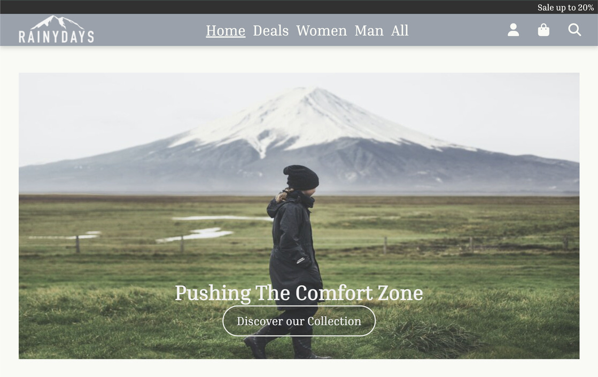

# RainyDays


Explore the website by visiting the link: [RainyDays](https://rainjackets.netlify.app/)



## Description

RainyDays is an online shop for rain jackets, built with plain HTML, CSS and JavaScript. It was my very first website, made by [Nikita Fedorov](https://www.linkedin.com/in/nikita-fedorov-757aaa402/) as the first task at Noroff.

I had just learned some design, HTML and CSS, and could choose between three ideas with ready made images. I went with jackets. At first the website had no JavaScript, and no loading or error messages. Later in my studies I came back to it, added JavaScript and jackets from the Noroff API, and used it again in the Interaction Design course.

There is no real payment. The bag, checkout and payment pages show the flow, but they are not connected to the jackets you add.

### Features

- Home page with a scrollable row of jackets and links to the Men and Women collections
- Deals page that only shows the jackets on sale
- Women and Man pages that show the jackets for each gender
- List of Jackets page with every jacket
- Details page with the price, discount, colour and description of one jacket
- Add to bag saves the jacket in local storage and turns the bag icon red
- Loading message while the jackets are fetched, and an error message if the API fails
- Checkout and payment split into separate pages, with validation on the checkout form
- Contact form and newsletter sign up, both with a confirmation message
- Responsive layout for phone, tablet and desktop

## Built With

- Language = HTML, CSS and JavaScript (ES modules)
- API = Noroff Rainy Days API
- Icons = Font Awesome
- Fonts = Google Fonts
- Analytics = Hotjar
- Editor = Visual Studio Code
- Hosting = Netlify

## How It Works

Jackets come from the Noroff Rainy Days API. The url is in `js/constants.js`.
Every page that lists jackets has its own script in `js/`, and gets them through `fetchData` in `js/api/fetchData.js`. It returns the jackets from the response, or throws an error if the request fails.
While the jackets load, the page shows a Loading box. If something goes wrong, the box is replaced with an error message.
The details page reads the jacket `id` from the URL with `getQueryParam` and fetches only that jacket.
When you click Add to bag, `handleClick` saves the jacket id in local storage and turns the bag icon in the header red.

## Project Structure

```
.
├── js/
│   ├── api/          # fetchData, and the code that builds the jacket cards and details
│   ├── handler/      # form handler
│   ├── helper/       # add to bag, query params and form validation
│   ├── ui/           # error message and Hotjar
│   ├── constants.js  # API url
│   └── ...           # one script per page, like index.js and deals.js
├── pictures/         # images used on the website
├── fonts/
├── pictureGit/       # image for this README
├── styles.css        # all styles and media queries
└── *.html            # one file per page
```

## Getting Started

### Prerequisites

- A browser
- A local server, for example the Live Server extension in Visual Studio Code

The scripts are ES modules, so the jackets will not load if you open the html files straight from the folder. You don't need any environment variables or dependencies.

### Installing

1. Clone the repo:

```bash
git clone https://github.com/Nikita-stud/Interaction-Design.git
```

### Running

Open the folder in Visual Studio Code and click Go Live. If you have Node.js, you can also run the following command in the folder:

```bash
npx serve .
```

Then open the address it shows in your browser.

## Roadmap

- [x] Jackets from the Noroff API
- [x] Loading and error messages
- [x] Updated to version 2 of the Noroff API
- [ ] Show the saved jackets on the bag page

## Contributing

This was my very first website, so I am leaving it mostly as it is, as a tribute to where it all started. If you find a bug or have an idea, open an issue or a pull request and I will take a look.

## Contact

You can always contact me through the official Noroff portal, or reach me here:

- [GitHub](https://github.com/Nikita-stud)
- [LinkedIn](https://www.linkedin.com/in/nikita-fedorov-757aaa402/)
